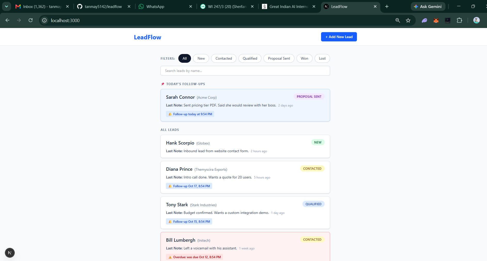
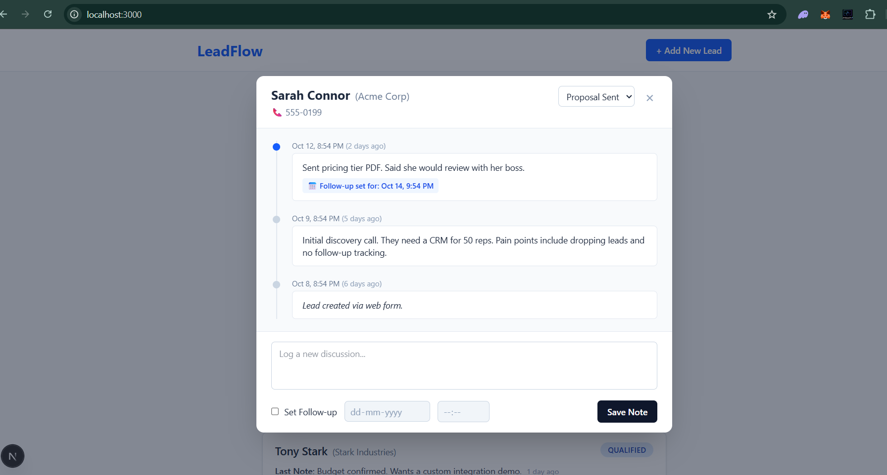
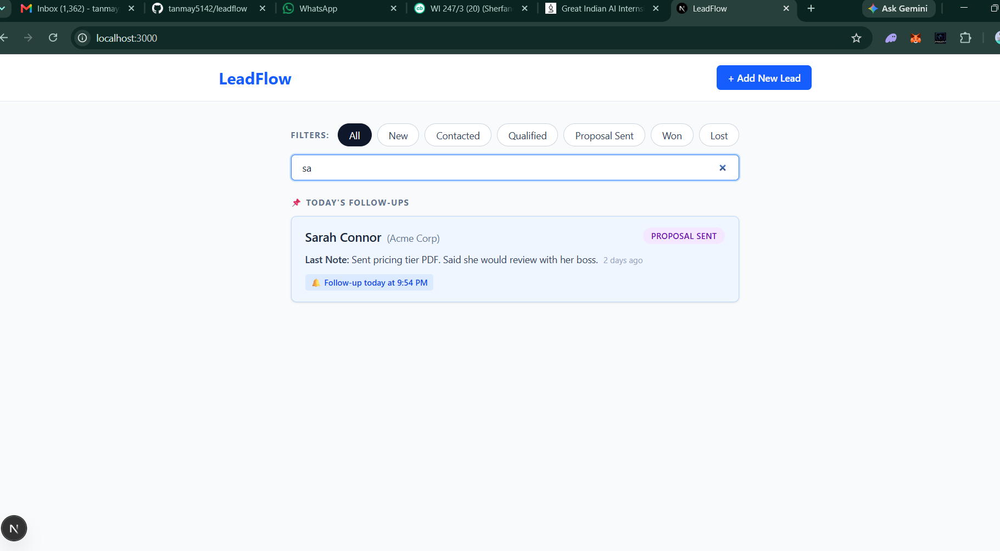
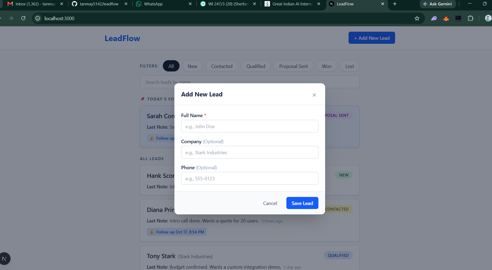

# LeadFlow

A lightweight lead management tool (mini CRM). A sales rep can track leads, log every discussion, set follow-up reminders, and see today's follow-ups at the top of the list.

Built for the PravarAI full-stack intern assessment.

**Demo video:** https://drive.google.com/file/d/1w8nPIrvjNahshXc5S-HM1Uqx-wSgrM8-/view?usp=drive_link

## Screenshots

| Lead list | Timeline dialog |
|---|---|
|  |  |

| Filter and search | Add new lead |
|---|---|
|  |  |

## Features

**Required**
- Lead list with name, company, status badge, last note, and "time ago"
- Today's follow-ups pinned at the top
- Click a lead to open a dialog (not a new page) with the full discussion history, newest first
- Add a note with an optional follow-up date and time. The list updates immediately
- Change the status from the dialog (saved in the database)
- Add a new lead (name required, company and phone optional, status starts as New)

**Bonus**
- Search leads by name
- Overdue follow-ups are highlighted in red
- Filter by status
- Docker Compose setup
- Seed script with 7 leads and 15 discussions

## Tech stack

- **Frontend:** Next.js (App Router), TypeScript, Tailwind CSS
- **Backend:** FastAPI, SQLAlchemy, Pydantic
- **Database:** SQLite

## Quick start with Docker (easiest)

You need [Docker Desktop](https://www.docker.com/products/docker-desktop/) running.

```bash
git clone https://github.com/tanmay5142/leadflow.git
cd leadflow
docker compose up --build
```

Then open:
- App: http://localhost:3000
- API docs: http://localhost:8000/docs

The database is filled with sample leads the first time it starts. Your data is kept between restarts.
To stop: press `Ctrl + C`, then run `docker compose down`.
To reset all data: `docker compose down -v`.

Optional: copy `.env.example` to `.env` to change the settings. The defaults work without it.

## Run without Docker

You need Python 3.10+ and Node.js 18+.

**1. Backend** (terminal 1)

```bash
cd backend
python -m venv .venv

# Activate it:
#   Windows (PowerShell):  .venv\Scripts\Activate.ps1
#   Mac / Linux:           source .venv/bin/activate

pip install -r requirements.txt
python -m app.seed            # adds sample data (use --reset to start fresh)
uvicorn app.main:app --reload
```

The API runs at http://localhost:8000 (docs at `/docs`).

**2. Frontend** (terminal 2)

```bash
cd frontend
cp .env.example .env.local    # Windows: copy .env.example .env.local
npm install
npm run dev
```

The app runs at http://localhost:3000.

## Environment variables

| Variable | Where | Default | What it does |
|---|---|---|---|
| `NEXT_PUBLIC_API_URL` | frontend / root | `http://localhost:8000` | Address of the API, used by the browser |
| `DATABASE_URL` | backend | `sqlite:///./leadflow.db` | Database location |
| `CORS_ORIGINS` | backend / root | `http://localhost:3000` | Websites allowed to call the API (comma separated) |

Example files: `.env.example`, `backend/.env.example`, `frontend/.env.example`.

## API

| Method | Endpoint | What it does | Success |
|---|---|---|---|
| GET | `/leads?status=&search=` | List leads, with optional filter and name search | 200 |
| POST | `/leads` | Add a lead | 201 |
| GET | `/leads/{id}` | One lead with its discussions (newest first) | 200 |
| PATCH | `/leads/{id}` | Change the status | 200 |
| POST | `/leads/{id}/discussions` | Add a note, optionally with a follow-up | 201 |
| GET | `/health` | Health check | 200 |

Errors: `404` if the lead does not exist, `422` for invalid input (empty name, unknown status, empty note, follow-up in the past). Every error has a readable `detail` message.

## Project structure

```
backend/
  app/
    main.py          app setup, CORS, error format
    database.py      database connection
    models.py        Lead and Discussion tables
    schemas.py       input checks and response shapes
    seed.py          sample data
    routers/leads.py all endpoints
frontend/
  src/
    app/             page and error page
    components/      LeadList, LeadCard, LeadDialog, Timeline, NoteForm, ...
    lib/             api calls, types, time and follow-up helpers
docker-compose.yml
```

## Decisions worth knowing

- **Times are stored in UTC** and shown in the user's own time zone. "Today" and "overdue" are decided in the browser using the user's local time.
- **Saving a note with a follow-up also updates the lead's follow-up**, in the same request. The API returns the full updated lead, so the dialog and the list refresh from one response.
- **Won and Lost leads** are never pinned and never shown as overdue.
- **The follow-up must be in the future** (checked in both the browser and the API).
- **Search is debounced** (300 ms) and old responses are ignored, so fast typing cannot show stale results.
- **No login**, since the task said it was optional.

## Use of AI

I used Claude (Anthropic) as a coding assistant. It helped me plan the structure, and it generated the first version of much of the backend and frontend code and this README. I ran and tested everything myself, fixed the problems I found, and I understand and can explain every part of the code.

## Possible next steps

- Login and per-user leads
- Pagination for large lead lists
- Edit and delete for leads and notes
- Automated tests